# Maintaining the GCSS website

A short guide for whoever updates the website. No web-development experience needed.
(This file stays in the repository; it is not part of the website.)

**The whole idea in three lines:**

1. Every page is a text file (`.md`) in the **`app/`** folder.
2. Folders become the **menu** automatically.
3. Photos and PDFs go in the **`contents/`** folder.

---

## 1. Start

Install [Node.js](https://nodejs.org) (version 20 or newer), then in a terminal inside this folder:

```sh
npm install     # first time only
npm run dev     # preview at http://localhost:3000
```

Keep `npm run dev` running. Save a file → refresh the browser → see the change.

When you're happy, publish with `npm run build` (see [section 8](#8-publish)).

---

## 2. Where things are

```
app/            ← pages (you work here)
contents/       ← images, logos, PDFs
scripts/site.config.js   ← email, social links, footer links
src/            ← design (rarely touched)
dist/           ← the generated website (never edit)
```

---

## 3. Files become pages and menus

| File | Web address |
|---|---|
| `app/page.md` | `/` (home) |
| `app/contact.md` | `/contact/` |
| `app/about/mission.md` | `/about/mission/` |

- **A file** → a link in the menu (e.g. *Contact*).
- **A folder with files** → a dropdown (e.g. *About ▾*). The folder's own page is `page.md` inside it.
- **Names:** lowercase with hyphens, e.g. `code-of-conduct.md`.

Example: create `app/about/history.md` and *History* appears under *About* and as a card on the About page.

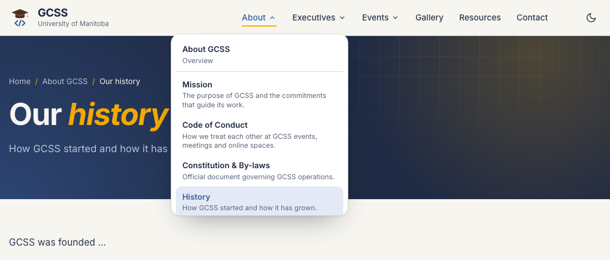

Section pages get these cards at the bottom automatically:

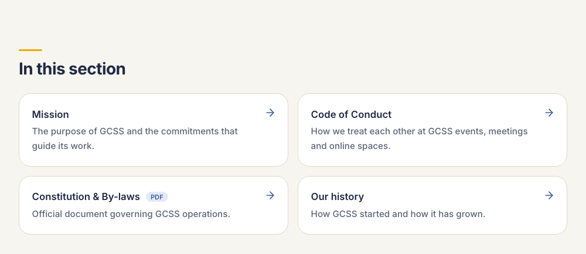

---

## 4. A page file

```markdown
---
title: Winter social
description: Hot chocolate and board games to close out the term.
---

# Winter *social*

Join us for the last social of the term. Everyone is welcome.

## What to bring

- Your favourite board game
- A friend from another lab
```

- The part between `---` lines is the **settings**.
- The first `# Title` goes in the navy banner. Words in `*stars*` turn gold.
- `description` appears under the title (and in Google).

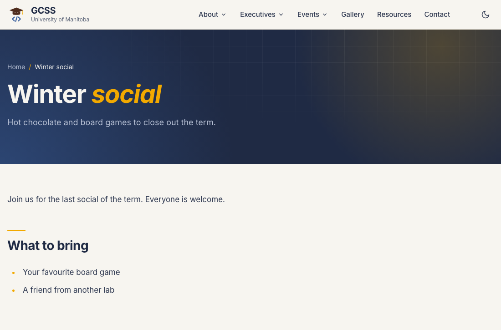

### Settings you can use

| Setting | Does | Example |
|---|---|---|
| `title` | Page title | `title: Our mission` |
| `description` | One-line summary | `description: Why GCSS exists.` |
| `nav` | Shorter menu label | `nav: Mission` |
| `order` | Menu position (small = first) | `order: 2` |
| `hidden` | Hide from menus | `hidden: true` |
| `draft` | Only visible in `npm run dev` | `draft: true` |
| `cover` | Big photo at the top | `cover: /contents/img/x.jpg` |
| `link` | Menu item opens this instead (no page) | `link: /contents/files/doc.pdf` |
| `photos` | Show every photo in a `contents/` folder as a grid | `photos: /contents/gallery/winter-social-2026` |

Events also use `date`, `time` and `location` (see [7.3](#73-add-an-event)).

---

## 5. Writing text, links and images

```markdown
## Section title

Some **bold**, some *italic*, a [link](mailto:pres@umgcss.org) and `code`.

- A bullet point
- Another one

1. First
2. Second

> A quoted line.

| Day      | Event            |
|----------|------------------|
| Thursday | CS Grad Seminar  |
| Friday   | Social           |
```

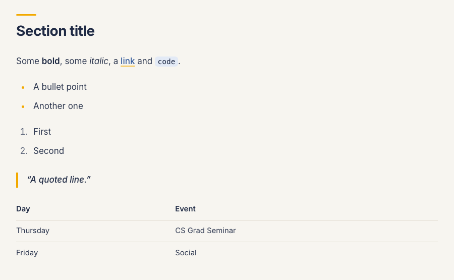

### Links

Link to the **`.md` file**. A leading `/` means "from the `app/` folder":

```markdown
Read our [mission](/about/mission.md) and [code of conduct](/about/code-of-conduct.md), or the [GCSS constitution (PDF)](/contents/files/GCSS-constitution.pdf).
```

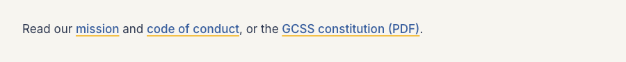

A broken link stops the build and tells you where it is, so mistakes never go live.

### Images

Put the image in `contents/`, then:

```markdown

```

- Text in `[ ]` describes the image (always write it).
- Text in `" "` is an optional caption.

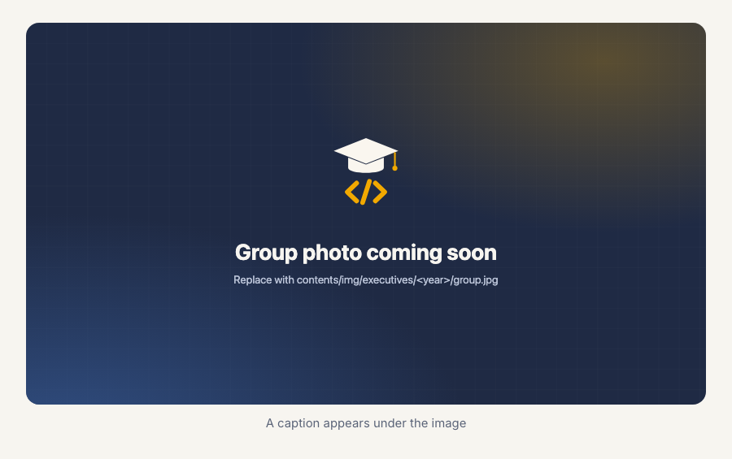

**Photo sizes:** member portrait 540 × 630 · group photo 1600 × 900 · event photo 1200 × 675. Use JPG.

---

## 6. Decorations (blocks)

Wrap content in `:::name` … `:::` to style it. Copy any example below.

### Intro paragraph

```markdown
:::intro
CS Grad Seminar is a biweekly event held by GCSS.
:::
```

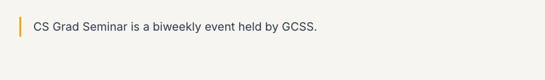

### Note and tip boxes

```markdown
:::note
**TL;DR:** Be a decent human being and don't be mean.
:::

:::tip icon=mail
The fastest way to reach us is [pres@umgcss.org](mailto:pres@umgcss.org).
:::
```

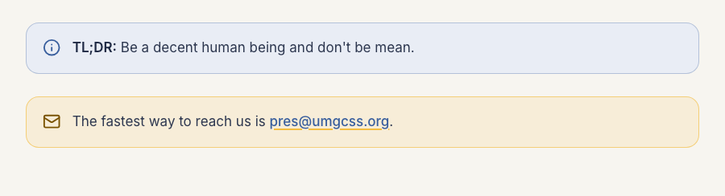

### Icon cards

```markdown
:::features
## What we do

Optional short introduction.

:::feature icon=megaphone
### Representation
We speak for CS graduate students at the department level.
:::
:::feature icon=users
### Community
Socials that bring every lab together.
:::
:::
```

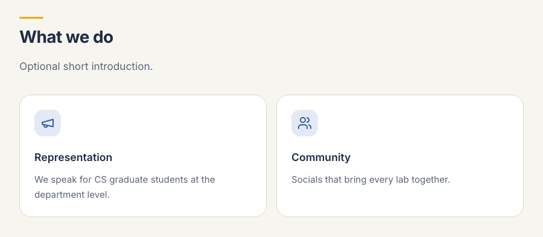

Icons: `megaphone` `presentation` `users` `wallet` `graduation` `shield` `heart` `network` `book` `calendar` `message` `code` `sparkles` `info` `lightbulb` `mail`

### Link cards

Link on the first line, description indented below.

```markdown
:::cards
## Get to know GCSS

- [Our mission](/about/mission.md)
  Why GCSS exists and what it works towards.
- [UMGPS](https://www.umgps.org/)
  The UM Graduate & Postdoctoral Society.
:::
```

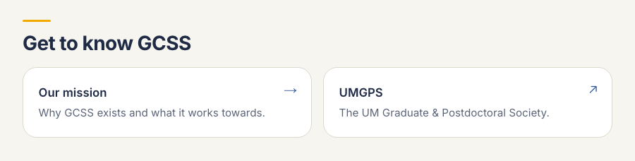

### Number tiles

```markdown
:::stats
- **30 min** talk
- **10 min** audience questions
- **Biweekly** during the term
:::
```

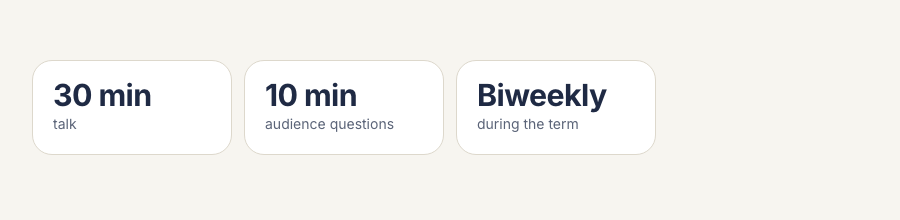

### Questions that open and close (FAQ)

```markdown
:::faq
### When will it start?
Hopefully this semester!

### What topics are allowed?
Anything under the computer science umbrella.
:::
```

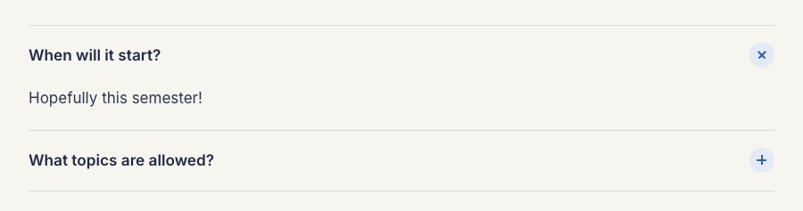

### Navy banner with buttons

```markdown
:::cta
## Ready to share your research?
Fill out the speaker form and we'll be in touch.

[Apply to speak](https://forms.gle/QLzSo6ymk1jhN4HE7) [Email us](mailto:pres@umgcss.org)
:::
```

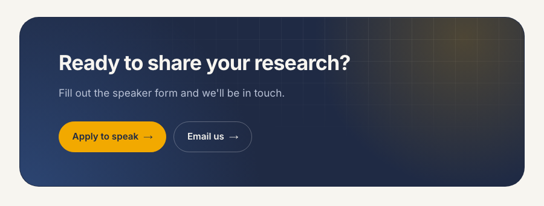

### Buttons

```markdown
:::buttons
[Go to the home page](/page.md) [Contact us](/contact.md)
:::
```

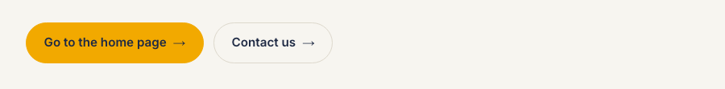

### Pill links ("jump to section")

```markdown
:::chips
- [Funding & fees](#funding-fees)
- [Wellbeing & support](#wellbeing-support)
:::
```

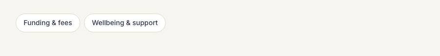

A heading's link name is its text in lowercase with hyphens: `## Funding & fees` → `#funding-fees`.

### People cards

```markdown
:::people
:::person name="Berkant Cunnuk" role="President" photo=/contents/img/executives/2026-2027/berkant-cunnuk.jpg
One or two sentences about the person.
- [Website](https://cnnk.xyz)
- [LinkedIn](https://linkedin.com/in/example)
- [Email](mailto:pres@umgcss.org)
:::
:::person name="Mehran Hossain" role="Senior Vice-President"
- [LinkedIn](https://ca.linkedin.com/in/mehran-hossain-5b168a1bb)
:::
:::
```

No photo → initials are shown. Links become icons automatically.

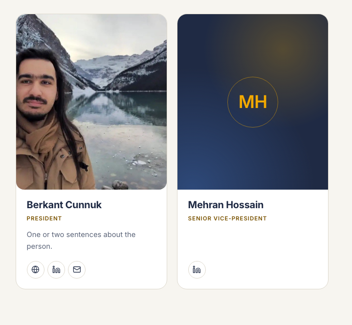

### Columns

```markdown
:::columns 3
:::col
### Room
EITC E2-110
:::
:::col
### Time
Thursdays, 3:30 PM
:::
:::col
### Contact
pres@umgcss.org
:::
:::
```

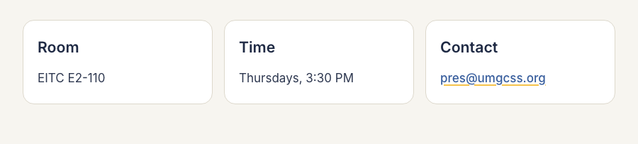

### Photo grid

Shows every photo in a folder (click one to view it full size):

```markdown
:::gallery folder=/contents/gallery/winter-social-2026
:::
```

### Home page banner (only in `app/page.md`)

```markdown
:::hero chips="Research talks,Socials,Advocacy"
# Graduate *Computer Science* Society

## A home for graduate students in Computer Science.

GCSS represents graduate students in the Department of Computer Science…

[Explore the seminar series](events/seminars.md) [Meet the executives](executives/2026-2027.md)
:::
```

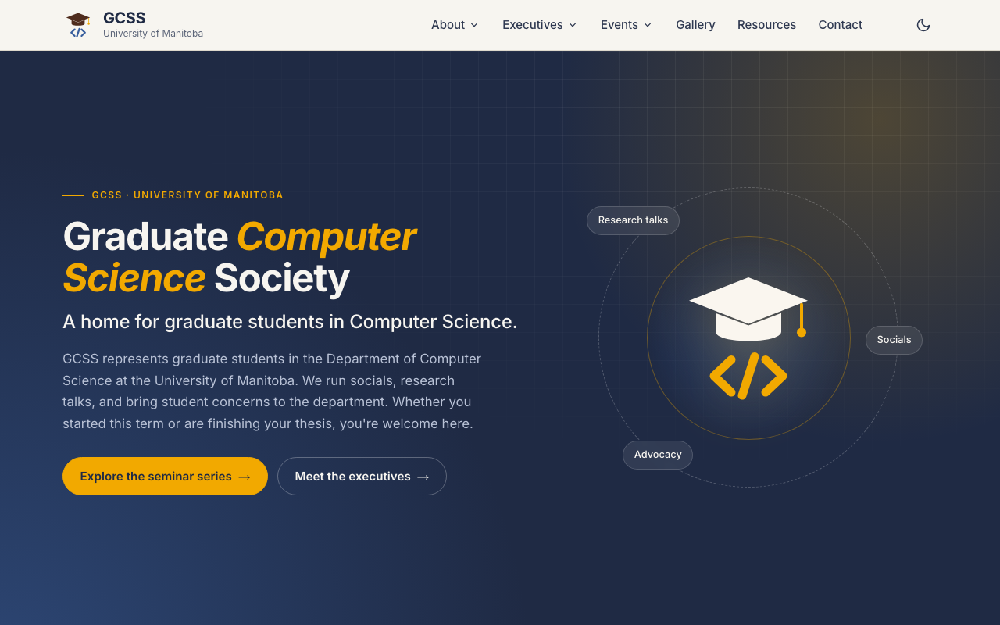

---

## 7. How do I…

### 7.1 Add a page

Create `app/sponsors.md`:

```markdown
---
title: Our sponsors
nav: Sponsors
description: The organisations that support GCSS events.
order: 4.5
---

# Our *sponsors*

Thank you to everyone who supports GCSS.
```

It appears in the menu between Resources (4) and Contact (5).

### 7.2 Add a page inside a section

Create the file inside the folder, e.g. `app/about/history.md`. It appears under *About*.

### 7.3 Add an event

Create `app/events/2026/winter-social.md`:

```markdown
---
title: Winter social
description: Hot chocolate and board games to close out the term.
date: 2026-12-10
time: 5:00 PM – 8:00 PM
location: EITC E2-110
cover: /contents/img/events/winter-social.jpg
---

# Winter *social*

Join us before the break.
```

That's all. It shows up automatically in the event lists, on the calendar and in the calendar download. After the date passes, it moves to *Recent events* by itself.

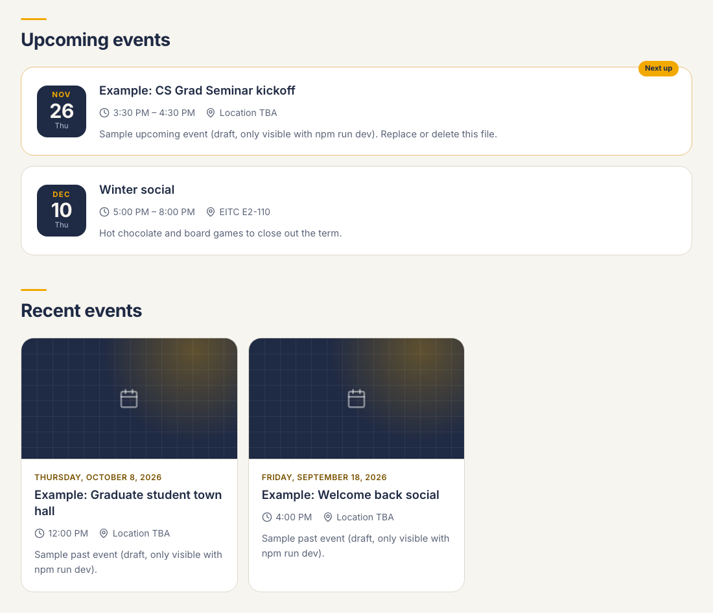

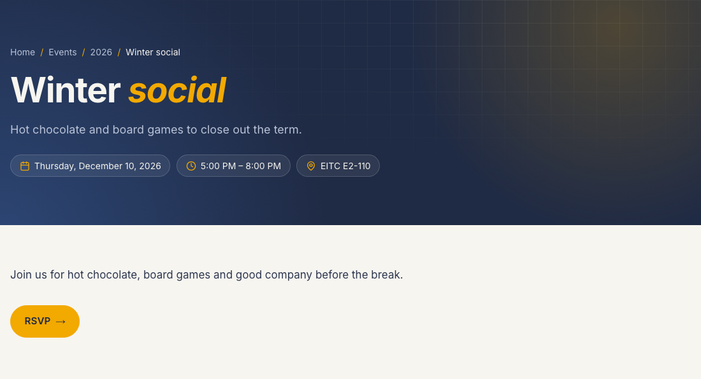

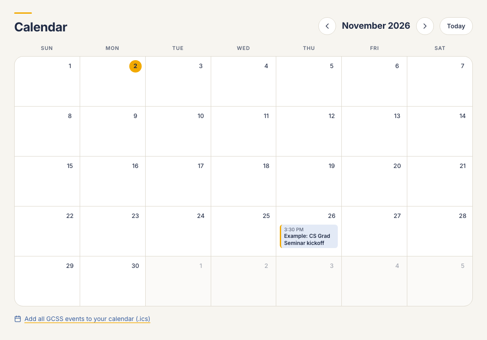

- `date` must look like `2026-12-10`.
- `cover` is optional.
- The `example-*.md` files in `app/events/2026/` are samples (drafts). Copy one to start, delete them anytime.

### 7.4 Add a new executive year

1. Put photos in `contents/img/executives/2027-2028/`: `group.jpg` plus one `firstname-lastname.jpg` per member.
2. Create `app/executives/2027-2028.md`:

   ```markdown
   ---
   title: GCSS Executives 2027-2028
   nav: 2027-2028
   layout: wide
   order: -2027
   cover: /contents/img/executives/2027-2028/group.jpg
   ---

   # Executives *2027–2028*

   :::people
   :::person name="Jane Doe" role="President" photo=/contents/img/executives/2027-2028/jane-doe.jpg
   One or two sentences about Jane.
   - [LinkedIn](https://linkedin.com/in/janedoe)
   :::
   :::
   ```

3. Search the `app/` folder for `2026-2027` and update links that should point to the new team.

`order: -2027` puts the newest year first. No group photo yet? Use `cover: /contents/img/executives/group-photo-placeholder.svg`.

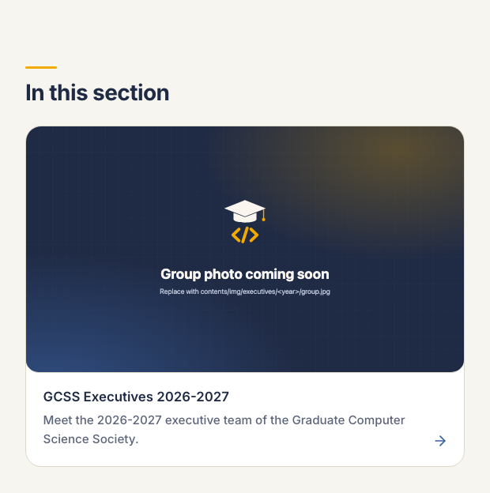

Ask members before using their photos.

### 7.5 Add a photo album

1. Put the photos in a new folder, e.g. `contents/gallery/winter-social-2026/`. They are shown in file-name order (`01.jpg`, `02.jpg`, …). Resize them to about 1600 px wide first.
2. Create `app/gallery/winter-social-2026.md`:

   ```markdown
   ---
   title: Winter social 2026
   description: Hot chocolate and board games to close out the term.
   date: 2026-12-10
   photos: /contents/gallery/winter-social-2026
   ---

   # Winter social *2026*

   Thanks to everyone who came!
   ```

That's all. The album appears as a card on the Gallery page (newest first; the first photo is the cover, or set `cover:`), and its page shows all the photos.

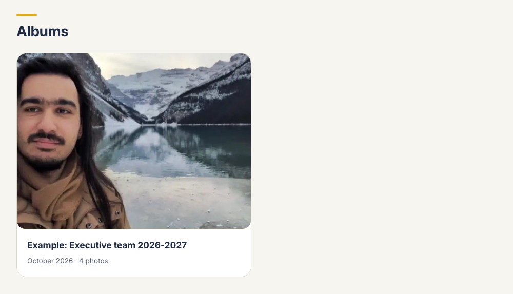


`app/gallery/example-album.md` is a draft sample; delete it whenever you like.

### 7.6 Add a resource

In `app/resources.md`, add two lines inside the right section:

```markdown
- [Graduate student workshops](https://umanitoba.ca/graduate-studies/student-experience/graduate-student-workshops)
  Workshops from the Faculty of Graduate and Postdoctoral Studies.
```

### 7.7 Change email, social or footer links

Edit `scripts/site.config.js`:

```js
email: 'pres@umgcss.org',
social: {
  instagram: 'https://www.instagram.com/umgcss',   // '' hides it
  github: 'https://github.com/UofM-GCSS',
  linkedin: '#',                                   // '#' = placeholder
},
```

### 7.8 Other quick changes

| I want to… | Do this |
|---|---|
| Rename a menu item | Change `nav:` |
| Reorder the menu | Change `order:` |
| Hide a page | Add `hidden: true` |
| Prepare a page privately | Add `draft: true` |
| Put a PDF in the menu | A page with only `title` and `link: /contents/files/x.pdf` |
| Edit the home page | `app/page.md` |
| Change colours | Top of `src/styles.css` |

---

## 8. Publish

The site publishes itself: **every push to `main` rebuilds it and puts it on GitHub Pages** (see `.github/workflows/deploy.yml`). It also rebuilds every Monday, so event lists and the calendar stay current. To publish by hand, open the repository's **Actions** tab → *Deploy to GitHub Pages* → **Run workflow**.

- Live address: `https://masud70.github.io/GCSS/` (or the custom domain, once one is set in **Settings → Pages**; nothing else needs to change).
- Drafts are never published.
- To test the production build locally: `npm run build` (output in `dist/`).

---

## 9. If something goes wrong

The build stops and names the file when something is broken:

| Message says | Fix |
|---|---|
| `missing page "…"` | Fix the link path (use `/` to start from `app/`) |
| `missing file "…"` | Check the file name in `contents/` |
| `is never closed` | Add a closing `:::` |
| `unknown block` / `unknown icon` | Fix the spelling (see section 6) |
| `are the same page` | You have both `x.md` and `x/page.md`; keep one |
| `date must look like 2026-11-20` | Fix the event date |

Warnings (the build continues) point out missing image descriptions, odd file names or placeholder social links.

**Change not showing?** Make sure `npm run dev` is running, save the file, and refresh the browser.

---

### Before you publish

- [ ] `npm run build` has no errors
- [ ] Checked the page in `npm run dev` (also in a narrow, phone-sized window)
- [ ] Every page has a `description`; every image has a description in `[ ]`
- [ ] People agreed to their photos
